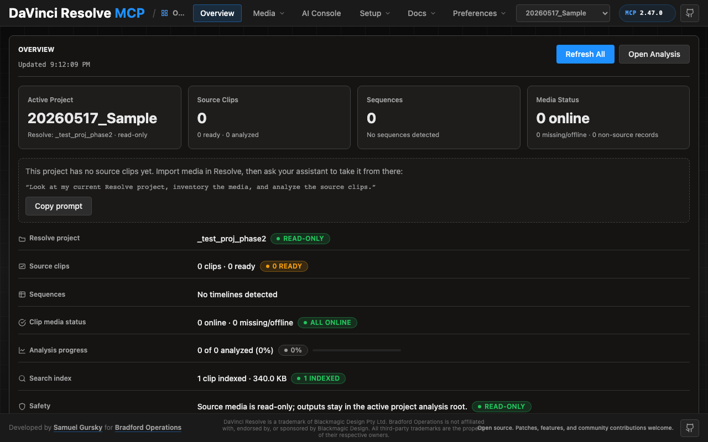

# DaVinci Resolve MCP Server

English | [简体中文](README.zh-CN.md)

[](https://github.com/ikislay/davinci-MCP/releases)
[](https://www.npmjs.com/package/davinci-resolve-mcp)
[](docs/reference/api-coverage.md)
[-blue.svg)](#server-modes)
[-18%20tools-blueviolet.svg)](#server-modes)
[](docs/reference/api-coverage.md#test-results)
[](https://www.blackmagicdesign.com/products/davinciresolve)
[](https://www.python.org/downloads/)
[](https://opensource.org/licenses/MIT)

A Model Context Protocol (MCP) server that lets AI assistants control DaVinci Resolve Studio through the official Scripting API. It provides full API coverage plus guarded workflow helpers for editing, media pool organization, render setup, review markers, grading, Fusion, Fairlight, project lifecycle tasks, extension authoring, and source-safe media analysis.

[](docs/guides/control-panel.md)

A local browser control panel ships with the server for inspecting Resolve state, running source-safe analysis, drilling into analyzed clips and shots, and editing analysis output inline. See the [Control Panel Guide](docs/guides/control-panel.md) for the full tour.

---

## Quick Start

```bash
npx davinci-resolve-mcp setup
```

Before connecting, open DaVinci Resolve Studio and set **Preferences > General > External scripting using** to **Local**. (On the **free edition** that preference does not help — see [Free edition](#free-edition-in-app-bridge) below.)

The npm launcher installs a managed copy under your user application-data directory, then runs the universal Python installer. The installer creates a virtual environment, detects Resolve paths, and can configure Claude Desktop, Claude Code, Cursor, VS Code, Windsurf, Zed, Continue, Cline, Roo Code, OpenCode, Codex CLI, and JetBrains IDEs.

### Source install

```bash
git clone https://github.com/ikislay/davinci-MCP.git
cd davinci-resolve-mcp
python install.py
```

For platform paths, client-specific config, and manual setup, see [Installation and Configuration](docs/install.md).

The installer and server check the latest GitHub release for MCP updates. Checks are best-effort and throttled; the server never blocks MCP startup. The installer can prompt, snooze, ignore a release, disable checks, or apply an opt-in safe auto-update for clean git checkouts.

---

## Free edition (in-app bridge)

Blackmagic gates *external* scripting to Studio: on the free edition `scriptapp("Resolve")` refuses a foreign process, whatever the preference says.

Through Resolve 21.0.x the **Workspace ▸ Scripts** menu was not gated — a script launched from it is handed the live `resolve` object (measured on free 21.0.3.7) — so the server can reach the free edition through a small script that runs *inside* Resolve and re-exports it over an authenticated loopback listener. **Resolve 21.1 moved Python scripting to Studio.** On free 21.1 the Scripts menu no longer lists `.py` files at all. Treat the bridge as a 21.0.x path until that is measured.

```bash
python scripts/install_resolve_bridge.py
# restart Resolve, open a project, then: Workspace > Scripts > resolve_bridge
```

The installer and MCP client use `~/.config/davinci-resolve-mcp/bridge.json` by default. To keep the authenticated bridge config elsewhere, set `DAVINCI_RESOLVE_BRIDGE_CONFIG` while running the installer and in the MCP client environment; both sides will use that path.

Once that listener is running it is used **automatically** whenever external scripting is unavailable — no environment variable required. Setting `DAVINCI_RESOLVE_BRIDGE=1` *forces* the bridge instead: it becomes the only transport tried, so a bridge that stops answering reports its own fault rather than quietly falling back to another transport. Use it when the bridge is the path you intend to depend on.

### macOS Python setup

On macOS, Resolve looks for Python 3 in exactly two places: the `PYTHON3HOME` environment variable, then `/usr/local/bin/python3`. Homebrew, pyenv, uv and conda land in neither, so the script silently never appears in the menu. A python.org install works because its installer creates `/usr/local/bin/python3` — but you do not need one: point Resolve at the interpreter you already have, no `sudo` required.

```bash
launchctl setenv PYTHON3HOME "$(python3 -c 'import sys; print(sys.prefix)')"
```

Use `launchctl setenv`, not `export` — Resolve is launched from the Dock and never sees your shell's environment. Restart Resolve afterwards.

Validated on free 21.0.3.7 and Studio 19.1.3.7, both macOS. Windows and Linux paths are confirmed via user reports. Linux installs to `~/.local/share/DaVinciResolve/Fusion/Scripts/Utility`.

This is the documented in-app path, not a licence circumvention, but Blackmagic could close it — treat it as a supported-until-it-is-not tier. Loopback only, HMAC-signed requests, one-use nonces.

---

## Local Control Panel

Launch the single-user local control panel from the repository root:

```bash
venv/bin/python -m src.control_panel
```

The command starts a loopback-only server and opens the control panel in your browser at a URL that carries a per-launch access token (`http://127.0.0.1:8765/#token=…`) — use that exact URL; the panel refuses requests without it.

---

## Server Modes

| Mode | Entry point | Tools | Best for |
|------|-------------|-------|----------|
| Compound | `src/server.py` | 37 | Default mode for most assistants. Related Resolve operations are grouped behind action parameters to keep context usage low. |
| Full / granular | `src/server.py --full` or `src/resolve_mcp_server.py` | 390 | Power users who want one MCP tool per Resolve API method. |

The compound server is recommended unless you specifically need the granular one-tool-per-method surface.

### Advanced server — beyond the scripting API (optional, Node)

The package also ships a second, optional MCP server: **`davinci-resolve-advanced-mcp`** (`bin/davinci-resolve-advanced-mcp.mjs`). Where the Python server drives a *live* Resolve over the sanctioned scripting API, the advanced server does what the API **can't** — it reads and edits Resolve **files** (`.drp` / `.drt` / `.drx`) and applies DB/XML-level changes **with no Resolve running**, so it runs cloud *or* local.

It includes 18 tools covering grade codec, offline grading/QC catalog, conform, color trace, fusion, audio plan, fairlight, audio, project read, project DB, pipeline, capabilities, deliverable, media, editorial, and provenance. It can also be consumed **as a library** (importable engine API), not just spawned as a server.

Add it alongside the live server (both ship in one `npm install`):

```json
{
  "mcpServers": {
    "davinci-resolve": { "command": "<python>", "args": ["<path>/src/server.py"] },
    "davinci-resolve-advanced": { "command": "node", "args": ["<path>/bin/davinci-resolve-advanced-mcp.mjs"] }
  }
}
```

`install.py` prints both entries. Unlike the Python server, this one has Node dependencies. `npx davinci-resolve-mcp setup` installs them into the managed install and then registers the bin. If that install could not run — offline, or npm unavailable — setup registers an `npx` command for the advanced server instead. To repair an existing install without re-running setup: `npx davinci-resolve-mcp sync`.

### Bradford Post Assistant — managed application (closed beta)

The maintainers also build **Bradford Post Assistant**, a desktop application on top of this open foundation. Where the MCP servers give an agent hands, Post Assistant is the working copilot around them — an on-device AI assistant for post-production where client material never leaves the workstation.

It is currently in **closed beta** — you can request access at [bradfordoperations.com/software/post-assistant](https://www.bradfordoperations.com/software/post-assistant). The open-source servers are complete and fully functional on their own.

---

## What You Can Do

```text
"List all projects and open the one called 'My Film'"
"Create a timeline called 'Assembly Cut' from all clips in the current bin"
"Build a multicam prep timeline from selected camera angles and preserve source media"
"Detect 2-pops or slate claps and suggest record offsets for sync prep"
"Publish analysis summaries, keywords, people, and slate hints into Resolve clip metadata"
"Probe this timeline for gaps, overlaps, missing media, and source frame ranges"
"Safely import this image sequence, organize it into bins, and normalize clip metadata"
"Build a ProRes 422 HQ render plan, validate the settings, and queue the job"
"Copy review markers from the timeline to the selected clip and export a review report"
"Snapshot this clip's grade, validate a CDL update, and export a temp LUT"
"Create a Fusion TextPlus overlay on the selected clip and verify graph connections"
"Report audio channel mappings, voice isolation availability, and subtitle support"
"Install this MCP-marked DCTL or script, classify refresh/restart needs, then remove it"
```

---

## Core Capabilities

| Area | What the compound server supports |
|------|-----------------------------------|
| App and project control | Launch/reconnect, page switching, project CRUD, project folders, databases, cloud project wrappers, settings, presets, archives |
| Media pool and ingest | Safe import, image sequences, multicam prep timelines, bin organization, metadata normalization, metadata field inventory, marks, annotations, relink/proxy/full-resolution guards |
| Media analysis | Source-safe file/clip/bin/project analysis, 2-pop/slate-clap sync-event detection, default Resolve metadata and Media Pool marker writeback, persisted analysis artifacts, host chat visual analysis, transcription with opt-out |
| Timeline editing and conform | Track/item probing, title text key scans/writes, copy/move/duplicate helpers, ripple insert, range operations, gaps/overlaps, source ranges, checked interchange exports/imports |
| Review annotations | Timeline/item/clip markers, custom data, flags, clip color, copy/move/sync cleanup, review reports, marker thumbnail review |
| Color and grading | Node graph probing, CDL validation, grade copy, DRX/LUT helpers, versions, Gallery stills, color groups |
| Fusion | Timeline-item comps, safe tool creation, input writes, port inspection, validated connections, scoped bulk writes |
| Audio and Fairlight | Track/item probes, source mapping, guarded audio property writes, voice isolation, auto-sync planning, transcription/subtitle probes |
| Render and deliver | Format/codec matrix probing, render settings validation, queued job lifecycle checks, guarded Quick Export |
| Extension authoring | Fuse, DCTL, ACES DCTL, and Resolve-page Lua/Python script lifecycle helpers with safe MCP-marked install/remove |
| Craft guidance | Bundled editorial, colour, audio, and workflow guidance served as prose over MCP |

### Operation envelope

Every compound tool return carries an `_operation` block beside its payload, so an agent reads one shape instead of a different key per tool: `status` (`success` / `partial` / `blocked` / `failed`), `verification` (with `contradiction` kept distinct — Resolve reported success and the readback disagreed), `changes` (the semantic delta), `warnings`, and an `execution_id`.

---

## Source Media Safety

This project treats camera originals and source media as immutable. Analysis tools read source files and write reports only to sidecar, scratch, or project analysis directories; confirmed metadata publishing writes only to Resolve's project database. The server must not modify, transcode, proxy, or create derivatives of source media unless the user explicitly asks for that. See [Media Analysis Guide](docs/guides/media-analysis-guide.md) for the detailed source-safe workflow.

---

## Security Posture

The default server is a local stdio process launched by your MCP client; it does not expose a network listener or built-in multi-user auth surface. The two opt-in local HTTP surfaces — the control panel and the networked MCP transport — bind loopback only and require a per-launch bearer token on every request, with Host/Origin checks against DNS rebinding and CSRF.

Destructive writes on both servers honour `destructive.safe_mode` and the security audit log; only the compound server archives a timeline before mutating it — granular writes are refused or recorded, never recovered. See [Security Policy](SECURITY.md) for operational boundaries, confirmation guidance, and vulnerability reporting.

---

## Key Stats

| Metric | Value |
|--------|-------|
| MCP Tools | **37** compound / **390** granular (live server) |
| Advanced (offline) tools | **18** — .drp/.drt/.drx + DB authoring, no Resolve running |
| Kernel Actions | **136** guarded workflow actions across 9 compound tools |
| API Methods Covered | **361/361** (100%) |
| Methods Live Tested | **338/361** (93.6%) |
| Live Test Pass Rate | **338/338** (100%) |
| Tested Against | DaVinci Resolve 19.1.3 Studio + Resolve 20.3.2 Studio + Resolve 21.0.2 Studio + Resolve 21.0.3 **free** (via the in-app bridge) |

For method-by-method status, see [API Coverage and Test Results](docs/reference/api-coverage.md). For current workflow support, see [Kernel Action Coverage](docs/kernels/README.md).

---

## Documentation

| Document | Use it for |
|----------|------------|
| [Installation and Configuration](docs/install.md) | Requirements, installer options, supported clients, server modes, manual config |
| [API Coverage and Test Results](docs/reference/api-coverage.md) | Key stats, API coverage table, live-test status, full method reference |
| [Kernel Action Coverage](docs/kernels/README.md) | Current guarded workflow action map |
| [AI Skill Reference](docs/SKILL.md) | Operational context for AI assistants using the compound server |
| [Control Panel Guide](docs/guides/control-panel.md) | Local browser panel tour |
| [Media Analysis Guide](docs/guides/media-analysis-guide.md) | Source-safe FFprobe, FFmpeg, Whisper, sidecar, and analysis-root workflows |
| [Multicam Setup Helper Guide](docs/guides/multicam-setup-guide.md) | Stacked timeline prep, helper/API boundary, and Resolve UI conversion steps |
| [Editorial Decision Guide](docs/guides/editorial-decision-guide.md) | Project-owned editorial craft guidance for analysis and timeline decisions |
| [Conforming an Avid AAF](docs/guides/conforming-an-avid-aaf.md) | Why all three Resolve-native routes fail on a consolidated turnover, and which one is dangerous |
| [Native .drt Authoring](docs/guides/native-drt-authoring.md) | Offline template-spliced timeline authoring |
| [Headless Edit Loop](docs/guides/headless-edit-loop.md) | Driving Resolve from the command line |
| [Color Decision Guide](docs/guides/color-decision-guide.md) | Project-owned color correction guidance and Resolve color API boundaries |
| [Contributing and Project Layout](docs/contributing.md) | Contribution workflow, platform support, security notes, repository structure |
| [Security Policy](SECURITY.md) | Local stdio trust boundary, tool metadata, confirmation guidance, reporting |
| [Release Process](docs/process/release-process.md) | Maintainer release checklist, version surfaces, validation, tags, and release notes |
| [Changelog](CHANGELOG.md) | Historical release notes |

Extension authoring references live in [docs/authoring](docs/authoring/). Resolve developer-package notes live in [docs/notes](docs/notes/) and [docs/integrations](docs/integrations/). Prompt recipes live in [examples](examples/).

---

## Requirements

- DaVinci Resolve 18.5+ on macOS, Windows, or Linux. **Studio** supports external scripting directly. The **free edition** does not — Blackmagic gates external scripting to Studio — but it is still reachable through the [in-app bridge](#free-edition-in-app-bridge).
- Python 3.10+ (3.10-3.12 is the lowest-risk range). Python 3.13/3.14 also work on recent Resolve builds (verified on Studio 20.3.2); older builds may fail to connect on 3.13+, in which case use 3.10-3.12.
- Not connecting? `python3 scripts/doctor.py` checks the Python the server runs on and prints the exact fix for each problem.
- Resolve external scripting set to **Local** (Studio). On the free edition this preference has no effect — use the [in-app bridge](#free-edition-in-app-bridge) instead.

Resolve 19.1.3 remains the compatibility baseline. Resolve 20.x scripting calls are additive, version-guarded, and live-tested on 20.3.2. Resolve 21.0 scripting additions are exposed behind runtime capability detection, so they stay inert on older builds and activate automatically on Resolve 21+.

---

## Reporting Bugs and Requesting Features

Tell your assistant "send this as a bug" or "send this as a feature request". It drafts a GitHub issue from the conversation, including the failing call and its error, and attaches the server version, Resolve build, connection mode and OS. Local paths, your username and anything that looks like a secret are redacted. Nothing is filed for you: you get a prefilled link, review the draft, and submit it on GitHub yourself. You can also [open an issue](https://github.com/ikislay/davinci-MCP/issues/new/choose) directly.

---

## Development

```bash
python src/server.py          # Compound server
python src/server.py --full   # Granular server
venv/bin/python tests/test_import.py
venv/bin/python scripts/audit_api_parity.py
```

Release and validation rules are in [docs/process/release-process.md](docs/process/release-process.md). AI agents working in this repository should start with [AGENTS.md](AGENTS.md); Claude Code users can also read [CLAUDE.md](CLAUDE.md), which points to the same canonical instructions.

---

## License

MIT

---

## Author

ikislay  
GitHub: [github.com/ikislay](https://github.com/ikislay)

---

## Acknowledgments

- Blackmagic Design for DaVinci Resolve and its scripting API
- The Model Context Protocol team for enabling AI assistant integration
